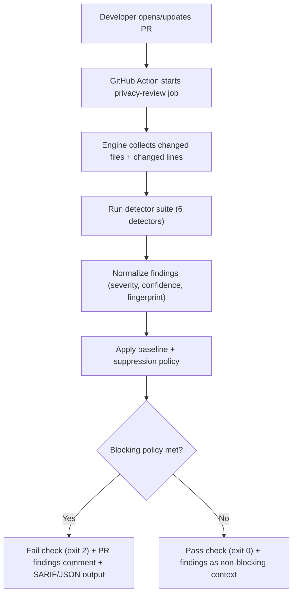
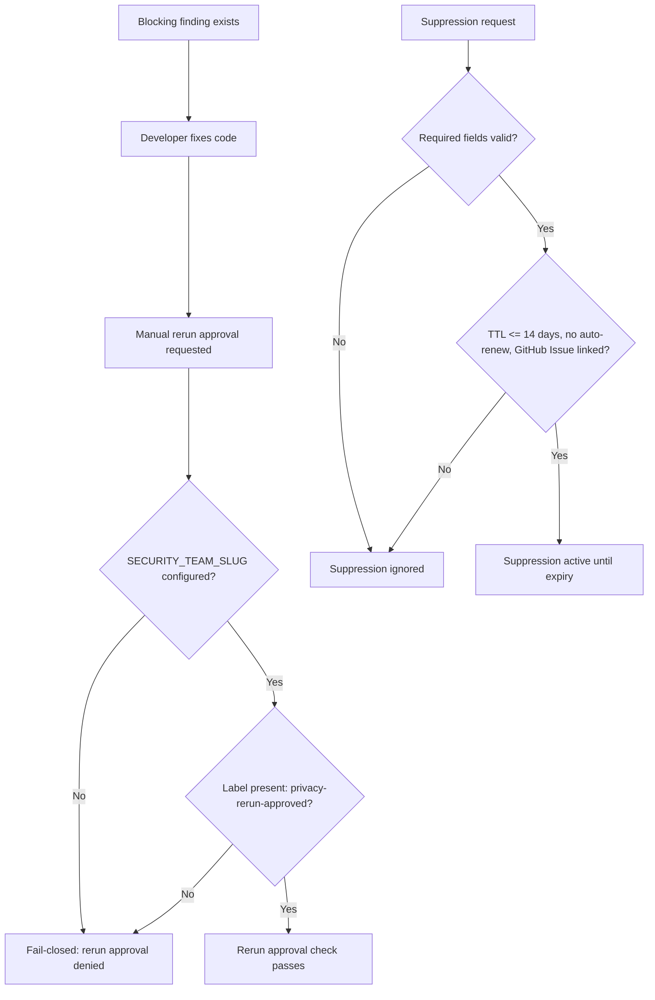

# Privacy Review Agent Architecture

This document explains how the system works at a high level for engineering, security, privacy, and leadership stakeholders.

## 1) System Purpose

Privacy Review Agent is a pull-request gate that prevents risky privacy/security code from merging.

It detects:

1. Secrets in code
2. Raw PII logging
3. Unsafe third-party transfer
4. PII/quasi-identifiers in LLM prompts
5. Missing redaction/masking
6. Policy bypasses

## 2) End-to-End Flow

## 3) Core Components

1. `CLI` (`scan`, `baseline create`, `enforce-rerun-approval`, `calibrate`)
2. `Engine` (orchestration, dedupe, gating, baseline/suppression handling)
3. `Detectors` (category-specific scanners; keyword matching is whole-word and
   identifier-aware, full-line `#`/`//` comments are skipped, and secrets merge
   built-in regex results with gitleaks findings)
4. `Policies` (YAML rule/config packs)
5. `Reporters` (Markdown, JSON, SARIF outputs)
6. `CI Workflow` (GitHub Actions integration and enforcement)

## 4) Decision Logic

A finding blocks merge only if all conditions are true:

1. Severity is `critical` or `high`
2. Confidence is `high`
3. Tier is `confirmed` (matched by a structural rule, not a keyword match alone)
4. Finding is on changed PR lines
5. Not in active suppression
6. Not in baseline snapshot

Phase 1 keyword-only hits are advisory until structural rules confirm them.

## 5) Governance and Controls

Suppression requirements:

1. `reason`
2. `privacy_approver`
3. `security_approver`
4. `created_on`
5. `expires_on` (max 14 days from creation)
6. GitHub Issue ticket URL
7. `auto_renew` must be false/absent

## 6) Operating Modes

1. Offline-first (default)
2. Optional controlled verifier egress for supported secret checks
3. GitHub-only MVP workflow

## 7) Outputs for Stakeholders

1. PR check status (pass/block)
2. PR-ready Markdown findings with remediation hints
3. SARIF for security tooling
4. JSON report artifact (90-day retention in current workflow)
5. Calibration metrics (fixture precision and recall, per-detector precision
   and recall over the labelled corpus scored by the new `calibration` module,
   determinism)

## 8) Current Go-Live Blockers

1. Security team slug (`org/team-slug`) for rerun-approval authorization
2. Pilot repository (`org/repo`) for first production rollout
