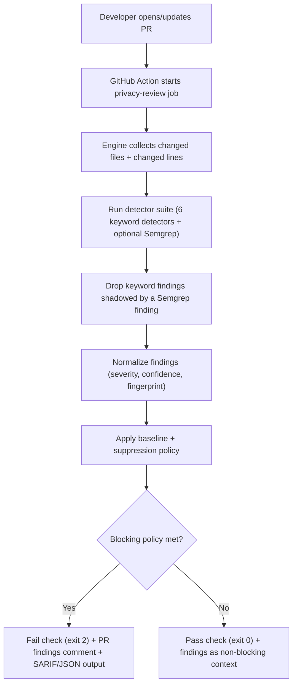
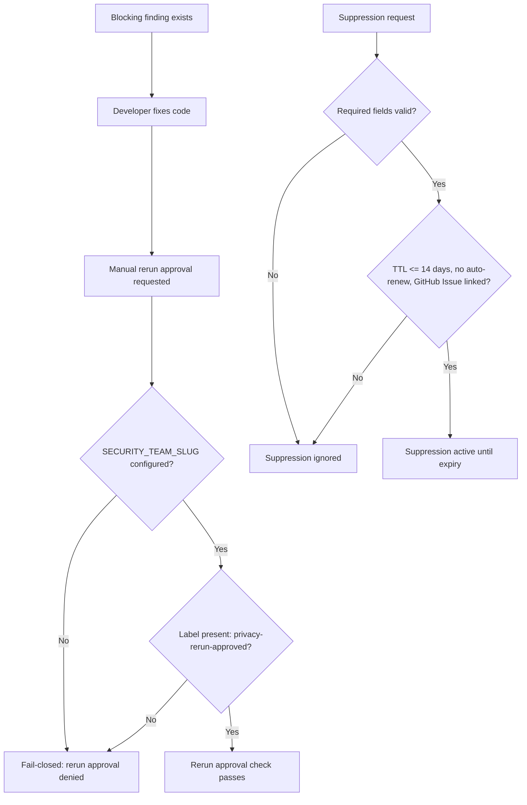

# Privacy Review Agent Architecture

This document explains how the system works at a high level for engineering, security, privacy, and leadership stakeholders.

## 1) System Purpose

Privacy Review Agent is a pull-request gate that prevents risky privacy/security code from merging.

It detects:

1. Secrets in code
2. Raw PII logging
3. Unsafe third-party transfer
4. PII/quasi-identifiers in LLM prompts
5. Missing redaction/masking
6. Policy bypasses

## 2) End-to-End Flow

## 3) Core Components

1. `CLI` (`scan`, `baseline create`, `baseline migrate`, `enforce-rerun-approval`, `calibrate`)
2. `Engine` (orchestration, dedupe, gating, baseline/suppression handling)
3. `Detectors` (category-specific scanners; keyword matching is whole-word and
   identifier-aware, full-line `#`/`//` comments are skipped, and secrets merge
   built-in regex results with gitleaks findings; the optional `semgrep`
   detector runs Semgrep Community Edition offline over the scanned files with
   only the local rule pack and maps results to `confirmed` findings; the
   pack ships `python-raw-pii-logging` and `js-ts-raw-pii-logging`, which
   report raw PII reaching a logging sink as blocking `RAW_PII_LOGGING`,
   `python-pii-in-model-prompt`, which reports personal data sent to a
   model call as blocking `PII_IN_MODEL_PROMPT`,
   `python-pii-to-third-party`, which reports personal data sent through
   `requests`/`httpx` calls as blocking `THIRD_PARTY_PII_TRANSFER`, and
   `python-pii-to-telemetry`, which reports personal data sent to
   error-tracking and analytics SDKs as blocking
   `THIRD_PARTY_PII_TRANSFER`, and `python-pii-in-tool-result`, which
   reports personal data returned from an agent or MCP tool as blocking
   `PII_IN_MODEL_PROMPT`)
4. `Policies` (YAML rule/config packs)
5. `Reporters` (Markdown, JSON, SARIF outputs)
6. `CI Workflow` (GitHub Actions integration and enforcement)

## 4) Decision Logic

A finding blocks merge only if all conditions are true:

1. Severity is `critical` or `high`
2. Confidence is `high`
3. Tier is `confirmed` (matched by a structural rule, not a keyword match alone)
4. Finding is on changed PR lines
5. Not in active suppression
6. Not in baseline snapshot

Phase 1 keyword-only hits are advisory until structural rules confirm them.
When a Semgrep finding and a keyword-tier finding share file, line and
category, the structural finding wins and the keyword finding is dropped;
keyword findings with no structural match are untouched.

## 5) Governance and Controls

Suppression requirements:

1. `reason`
2. `privacy_approver`
3. `security_approver`
4. `created_on`
5. `expires_on` (max 14 days from creation)
6. GitHub Issue ticket URL
7. `auto_renew` must be false/absent

## 6) Operating Modes

1. Offline-first (default)
2. Optional controlled verifier egress for supported secret checks
3. GitHub-only MVP workflow
4. Review mode: `org` (default) or `personal`, via `--mode` or the
   `PRIVACY_REVIEW_MODE` env var (the workflow wires
   `vars.PRIVACY_REVIEW_MODE`, falling back to `org`)

In `personal` mode, a trailing `# privacy-ok: <reason>` or
`// privacy-ok: <reason>` comment on a finding's own line makes that finding
non-blocking. It still appears in every report, marked suppressed with its
reason. Inline markers bypass the approver, ticket and TTL suppression rules,
so they are personal-only: in `org` mode they are ignored and all output is
unchanged. In `personal` mode with an empty `SECURITY_TEAM_SLUG`,
`enforce-rerun-approval` skips with exit 0 instead of failing closed.

## 7) Outputs for Stakeholders

1. PR check status (pass/block)
2. PR-ready Markdown findings with remediation hints
3. SARIF for security tooling (the workflow uploads SARIF only on public
   repos or when the `PRIVACY_REVIEW_UPLOAD_SARIF` repository variable is
   `true`, and skips with a notice otherwise)
4. JSON report artifact (90-day retention in current workflow)
5. Calibration metrics (fixture precision and recall, per-detector precision
   and recall over the labelled corpus scored by the new `calibration` module,
   determinism, plus the Semgrep rule-test harness result when Semgrep is
   installed)

## 8) Current Go-Live Blockers

1. Security team slug (`org/team-slug`) for rerun-approval authorization
2. Pilot repository (`org/repo`) for first production rollout
