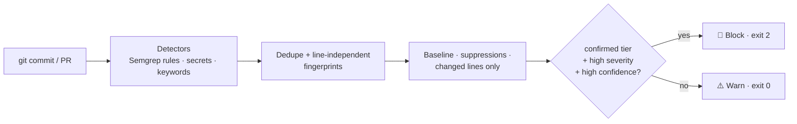

<div align="center">

# 🛡️ Privacy Review Agent

**Catch personal data leaks in your code before they ship.**

It finds the emails, phone numbers, SSNs and secrets that slip into logs, AI prompts,<br>
analytics and third-party APIs, right at `git commit`, offline and for free.


[What it catches](#-what-it-catches) · [Quick start](#-quick-start) · [How it decides](#-how-it-decides-what-blocks) · [Accuracy](#-accuracy-measured-not-guessed) · [Use it everywhere](#-use-it-everywhere) · [Reference](#-reference)

</div>

---

## ✨ In one glance

```python
def checkout(user):
    logger.info(f"Payment failed for {user.email}")        # 🚫 BLOCKED: personal data in a log
    openai.chat.completions.create(model="gpt-4o",
        messages=[{"role": "user", "content": user.phone}]) # 🚫 BLOCKED: personal data sent to an AI model
    sentry_sdk.set_user({"email": user.email})              # 🚫 BLOCKED: personal data sent to error tracking
    return redirect(f"/welcome?email={user.email}")         # 🚫 BLOCKED: personal data in a URL

    filename = f"{user.id}.pdf"                              # ✅ silent: "filename" isn't a person's name
    logger.info("Order %s shipped", redact(user.email))      # ✅ not blocked: redacted first
```

The agent reads code **structurally**: it follows personal data from where it comes from to where it ends up. It doesn't panic at every line that mentions `name` or `email`.

---

## 🤔 Why this exists

Privacy bugs are usually found too late: in a production incident, an audit or a breach. Secret scanners catch API keys but miss the quieter leaks: **a customer's email in a log line, a phone number in an LLM prompt, a user ID in an analytics event.**

Simple keyword scanners have the opposite problem. They flag `filename`, `translate` and `max_tokens`, block good commits, and developers learn to ignore them.

This project aims for the middle: **a scanner you can actually trust.**

| Principle | What it means |
|---|---|
| 🎯 **Few false alarms** | Only structurally confirmed findings block a commit. Keyword-only hits are warnings. |
| 📏 **Measured accuracy** | A 381-case labelled benchmark is checked on every change, and accuracy is part of the release gate. |
| 🔒 **Nothing leaves your machine** | No network calls, no telemetry, no AI. Same input, same output, every time. |
| 🧩 **Data, not code** | Sinks, vendors, sensitive fields and redaction helpers live in YAML you can edit. |

---

## 🔍 What it catches

| | Risk | Example sinks | Effect |
|---|---|---|---|
| 📝 | **Personal data in logs** | `logging`, `logger`, `print`, `console.*` (Python, JS/TS) | 🚫 Blocks |
| 🤖 | **Personal data sent to AI models** | OpenAI, Anthropic, Google Gemini | 🚫 Blocks |
| 🌐 | **Personal data sent to third parties** | `requests`, `httpx` (approved vendors are allowed) | 🚫 Blocks |
| 📊 | **Personal data in error tracking and analytics** | Sentry, Segment, PostHog, Datadog | 🚫 Blocks |
| 🧰 | **Personal data returned from AI agent / MCP tools** | tool functions whose results go back to the model | 🚫 Blocks |
| 🔗 | **Personal data in URLs and redirects** | Flask, Django, Starlette, FastAPI redirects, `url_for` | 🚫 Blocks |
| 🔑 | **Hard-coded secrets** | API keys, tokens, passwords (built-in patterns + [gitleaks](https://github.com/gitleaks/gitleaks)) | 🚫 Blocks |
| 🗄️ | **New database fields holding personal data** | Django models and migrations | ⚠️ Warns |
| 🙈 | **Missing redaction / privacy-check bypasses** | unmasked sensitive fields, consent checks hard-coded to pass | ⚠️ Warns |

Values passed through an approved helper (`redact`, `mask`, `hash`, `tokenize`) are recognised as safe.

---

## 🚀 Quick start

```bash
git clone https://github.com/mukta2701/shiny-invention.git
cd shiny-invention
pip install -e ".[semgrep]"        # the semgrep extra turns on structural rules (recommended)

privacy-review-agent scan --path ./src                               # scan a folder
privacy-review-agent scan --base-ref origin/main --head-ref HEAD     # scan only what changed
make demo                                                            # see a blocked scan and a clean one
```

Example report:

```
# Privacy Review Report

- Findings: 1
- Blocking: 1

## [BLOCK] SECRET_EXPOSURE — src/config.py:12
- Severity: `critical`
- Confidence: `high`
- Tier: `confirmed`
- Message: Potential hardcoded secret detected
- Remediation: Remove secret from code, rotate credential, move to a secret manager.
- Fingerprint: `f855efce34298464`
```

---

## 🧠 How it decides what blocks

Every finding gets an **evidence tier**:

- **`confirmed`**: a structural rule proved it. Semgrep taint rules traced personal data into a sink, or a secret pattern matched.
- **`keyword`**: a sensitive word and a sink appeared on the same line. Useful as a hint, but never enough to block.



Keyword matching is still smart. It is whole-word and identifier-aware, so `name` matches `userName` but not `filename`, `token` matches `authToken` but not `max_tokens`, and comments are skipped.

---

## 📏 Accuracy: measured, not guessed

Accuracy is measured on a labelled benchmark of **381 code snippets**. **203 of them are deliberate near-misses**: code that *looks* risky but isn't, like `email_count`, `settings.EMAIL_HOST` or a home-grown `redirect()` helper.

| Metric | Result |
|---|---|
| Near-miss precision (no false alarms on look-alikes) | **100%** |
| Recall on true leaks* | **100%** |
| Deterministic output | ✅ |
| Automated tests in CI (Python 3.11 + 3.13) | **460+** |

<sub>*Eight documented known gaps are excluded from recall and tracked in the corpus. The release gate requires near-miss precision > 90% and recall ≥ 80%. Run it yourself with `make calibrate`.</sub>

---

## 🔌 Use it everywhere

<details>
<summary><b>🪝 As a git pre-commit hook</b> (checks every commit on your machine)</summary>

```bash
mkdir -p ~/.git-hooks
cat > ~/.git-hooks/pre-commit << 'EOF'
#!/bin/bash
CODE_FILES=$(git diff --cached --name-only --diff-filter=ACM \
  | grep -E '\.(py|js|ts|tsx|jsx|yaml|yml|json|rb|go|java|env)$' || true)
[ -z "$CODE_FILES" ] && exit 0

BLOCK=0
for file in $CODE_FILES; do
  [ -f "$file" ] || continue
  privacy-review-agent scan --path "$file" --format md
  [ $? -eq 2 ] && BLOCK=1
done

if [ $BLOCK -eq 1 ]; then
  echo "Commit blocked: fix the risks above, or mark a reviewed line with '# privacy-ok: <reason>' (personal mode)."
  exit 1
fi
EOF
chmod +x ~/.git-hooks/pre-commit
git config --global core.hooksPath ~/.git-hooks
```

Emergency bypass: `git commit --no-verify`. Use it sparingly.
</details>

<details>
<summary><b>⚙️ In GitHub Actions</b> (blocks risky pull requests)</summary>

Copy [`.github/workflows/privacy-review.yml`](.github/workflows/privacy-review.yml) into your repo. On every pull request it scans only the changed lines, keeps a JSON report for 90 days, optionally uploads SARIF to GitHub Code Scanning, and fails the check on blocking findings.

| Setting | Purpose |
|---|---|
| `PRIVACY_REVIEW_MODE` (repo variable) | `org` (default) or `personal`. Personal repos without a security team should use `personal`. |
| `SECURITY_TEAM_SLUG` (secret) | `org/team-name`. Lets the team approve CI reruns, so findings can't be bypassed by re-running. |
| `PRIVACY_REVIEW_UPLOAD_SARIF` (repo variable) | `true` to upload SARIF on a private repo (needs GitHub Advanced Security). |
</details>

<details>
<summary><b>🤖 With your AI coding assistant</b> (Claude, Codex, Cursor…)</summary>

The output is machine-readable, so your assistant can run the scan and act on it. Add something like this to your `AGENTS.md` or `CLAUDE.md`:

```markdown
Before committing, run `privacy-review-agent scan --base-ref origin/main --head-ref HEAD --format json`.
Fix every blocking finding. For a false alarm, explain why; never add `# privacy-ok` without telling me.
```

Every `privacy-ok` suppression stays visible in every report, so an assistant can't quietly silence its own findings.
</details>

---

## 📚 Reference

<details>
<summary><b>Commands</b></summary>

```bash
# Scan a path, or only changed lines between two refs
privacy-review-agent scan --path <path> --format [md|json|sarif]
privacy-review-agent scan --base-ref <ref> --head-ref <ref> --format [md|json|sarif]

# Options
--mode org|personal                      # default org; reads PRIVACY_REVIEW_MODE
--baseline-file .privacy-review-baseline.json
--policies-dir ./my-policies             # bring your own YAML policies

# Adopt on an existing codebase: snapshot today's findings so they don't block
privacy-review-agent baseline create --ref HEAD --output .privacy-review-baseline.json
privacy-review-agent baseline migrate --baseline-file .privacy-review-baseline.json --output .privacy-review-baseline.json

# Check accuracy against the labelled benchmark
privacy-review-agent calibrate --fixture-set tests/fixtures

# CI: block reruns unless a label/team approves (skipped in personal mode)
privacy-review-agent enforce-rerun-approval --required-label privacy-rerun-approved
```

| Exit code | Meaning |
|---|---|
| `0` | No blocking findings (clean, or warnings only) |
| `1` | Runtime or configuration error |
| `2` | One or more blocking findings |

Output formats: **Markdown** (terminal / PR comments), **JSON** (scripts and AI assistants), **SARIF 2.1.0** (GitHub Code Scanning).
</details>

<details>
<summary><b>Suppressing false positives</b></summary>

**Inline (personal mode only).** Put a reason on the finding's own line:

```python
API_KEY = "sk_test_12345678901234567890"  # privacy-ok: test fixture
```

The finding stops blocking but is still listed in every report, marked suppressed with its reason. An empty reason suppresses nothing, and in `org` mode inline markers are ignored.

**File-based (both modes).** Add an entry to `.privacy-review-ignore.yaml`. Each entry needs approvers and a ticket, and expires after at most 14 days:

```yaml
max_ttl_days: 14
require_github_issue: true
entries:
  - id: f855efce34298464          # fingerprint from the JSON report
    reason: "Test fixture — not real PII"
    privacy_approver: your-name
    security_approver: your-name
    created_on: 2026-05-04
    expires_on: 2026-05-18
    ticket: https://github.com/your-org/your-repo/issues/42
```

Fingerprints don't depend on line numbers, so suppressions and baselines survive edits elsewhere in the file.
</details>

<details>
<summary><b>The Semgrep rule pack</b></summary>

[Semgrep](https://semgrep.dev/) Community Edition runs fully offline with only the local rules in [`policies/semgrep_rules/`](src/privacy_review_agent/policies/semgrep_rules/): metrics off, no registry, no network. Without the `semgrep` extra, scans still work (keyword and secret detectors only) and print one notice to stderr.

| Rule | Category | Blocks? |
|---|---|---|
| `python-raw-pii-logging`, `js-ts-raw-pii-logging` | `RAW_PII_LOGGING` | ✅ |
| `python-pii-in-model-prompt` | `PII_IN_MODEL_PROMPT` | ✅ |
| `python-pii-in-tool-result` | `PII_IN_MODEL_PROMPT` | ✅ |
| `python-pii-to-third-party` (checked against the vendor allowlist) | `THIRD_PARTY_PII_TRANSFER` | ✅ |
| `python-pii-to-telemetry` (Sentry, Segment, PostHog, Datadog) | `THIRD_PARTY_PII_TRANSFER` | ✅ |
| `python-pii-in-url` (framework-import aware) | `PII_IN_URL` | ✅ |
| `python-pii-schema-field` (Django) | `PII_SCHEMA_FIELD` | ⚠️ |

Sources are sensitive attribute, key or variable names and raw request bodies or headers. Values passed through an approved redaction helper are not reported. Secret scanning merges built-in patterns with gitleaks, run once per file with a 120-second limit.
</details>

<details>
<summary><b>Project layout</b></summary>

```
src/privacy_review_agent/
├── cli.py · engine.py · models.py      # commands, orchestration, findings + fingerprints
├── detectors/                          # secrets, semgrep, keyword detectors
├── reporters/                          # markdown · json · sarif
└── policies/                           # YAML: taxonomy, sensitive fields, vendors,
    └── semgrep_rules/                  #       redaction helpers + the Semgrep rule pack
tests/
├── unit/ · integration/
└── fixtures/                           # labelled corpus, safe + intentionally unsafe code
```

`tests/fixtures/unsafe/` holds **intentionally risky code** used to test the detectors, so scanning the whole repo will report findings there. That is expected.
</details>

---

## 🧭 Scope and limits

- **Python first.** Log scanning covers Python and JavaScript/TypeScript; the other structural rules are Python-only for now.
- **One function at a time.** Semgrep Community Edition tracks data within a function, not across files.
- **Deterministic by design.** There is no built-in AI judgment. Pair it with the AI assistant you already use (see above).

## 📖 Further reading

- [`ARCHITECTURE.md`](ARCHITECTURE.md): design decisions, blocking policy and operating modes
- [`docs/operations/runbook.md`](docs/operations/runbook.md): day-to-day use
- [`docs/operations/calibration.md`](docs/operations/calibration.md): accuracy targets and tuning
- [`src/privacy_review_agent/policies/semgrep_rules/README.md`](src/privacy_review_agent/policies/semgrep_rules/README.md): rule details

<div align="center"><sub>Built for developers who want privacy checks they can trust, not ones they learn to ignore.</sub></div>
