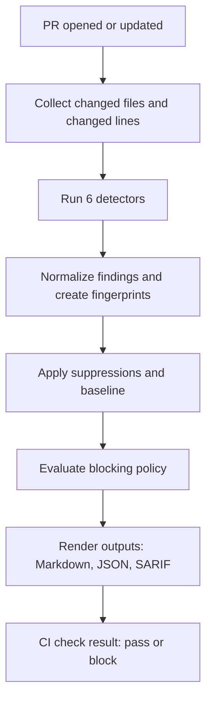
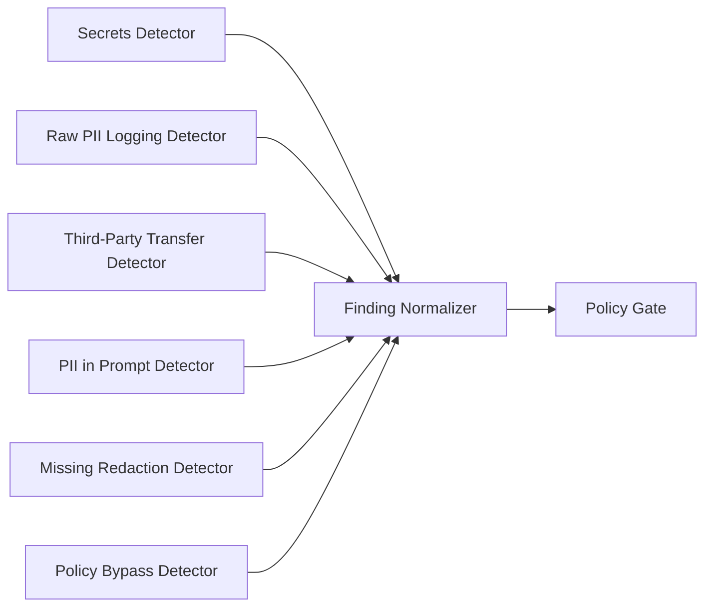
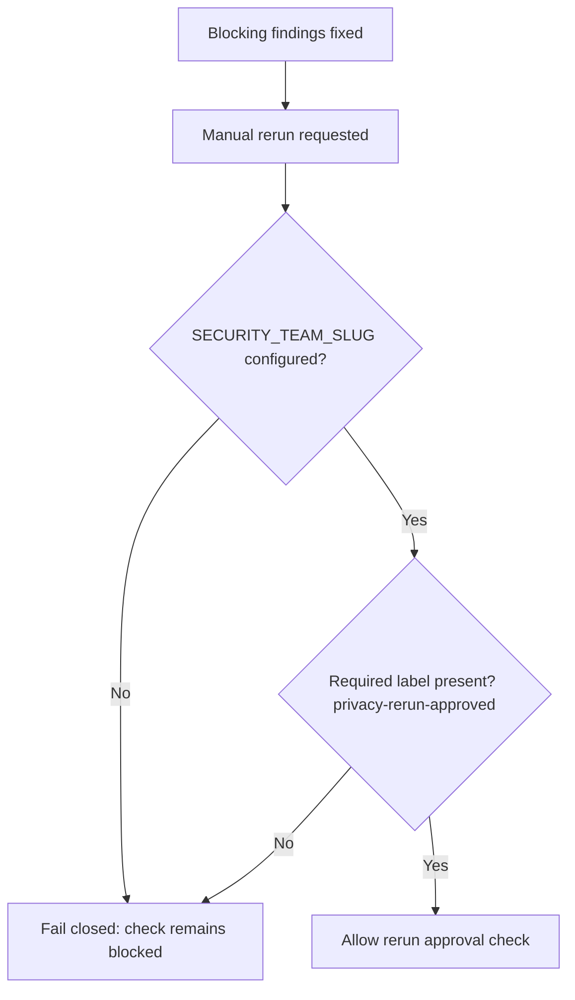

# Privacy Review Agent

Privacy Review Agent is an offline-first code-review gate for pull requests.
It detects privacy, sensitive-data, and policy-risk issues before merge.

## What This Project Does

It scans code and reports findings in 6 risk categories:

1. `SECRET_EXPOSURE`
2. `RAW_PII_LOGGING`
3. `THIRD_PARTY_PII_TRANSFER`
4. `PII_IN_MODEL_PROMPT`
5. `INSUFFICIENT_REDACTION`
6. `POLICY_BYPASS`

Each finding includes:

- category
- severity
- confidence
- file + line
- evidence
- remediation
- fingerprint
- blocking status

## How It Works (Step-by-Step)



### Detection Pipeline



## Blocking Rules

A finding blocks merge only when all are true:

1. severity is `critical` or `high`
2. confidence is `high`
3. finding is on changed PR lines
4. finding is not suppressed
5. finding is not in baseline

## Governance Model

### Suppressions

Suppressions are valid only if they include:

- `reason`
- `privacy_approver`
- `security_approver`
- `created_on`
- `expires_on`
- GitHub issue ticket URL

Rules:

- max TTL: 14 days
- no auto-renew
- expired suppressions are ignored

### Rerun Approval (Fail-Closed)



## Offline-First Behavior

- Default mode is offline.
- Secret verification egress is optional and explicit (`--allow-verifier-egress`).
- Without explicit online mode, no external verification calls are used.

## Command Reference

### 1) Scan PR diff

```bash
privacy-review-agent scan --base-ref origin/main --head-ref HEAD --format md
```

### 2) Scan a local folder

```bash
privacy-review-agent scan --path tests/fixtures/unsafe --format md
```

### 3) Create baseline snapshot

```bash
privacy-review-agent baseline create --ref HEAD --output .privacy-review-baseline.json
```

### 4) Enforce rerun approval gate

```bash
privacy-review-agent enforce-rerun-approval --required-label privacy-rerun-approved
```

### 5) Run calibration thresholds

```bash
privacy-review-agent calibrate --fixture-set tests/fixtures
```

## Quick Proof It Works

Run these from repo root:

```bash
make verify
```

Then run a demo scan:

```bash
make demo
```

Expected demo behavior:

1. Unsafe fixture scan exits `2` and shows blocking findings.
2. Safe fixture scan exits `0` with no findings.

## Recruiter Notes (Important Context)

This repository intentionally includes insecure snippets in test fixtures and design documents to validate detector behavior.
Those files are part of the test strategy, not production logic.

- Intentionally unsafe fixtures: `tests/fixtures/unsafe/`
- Design/plan docs may contain example bad patterns for demonstration.

If you scan the entire repository, you should expect many findings from those intentional examples.
To evaluate project quality and expected scanner behavior, run:

```bash
make verify
make demo
```

## Exit Codes

- `0`: no blocking findings
- `1`: runtime/config error
- `2`: blocking policy triggered

## Optional: Global Pre-commit Hook (Local Machine)

This is optional local setup and is not required by the repository itself.

```bash
python -m pip install -e .
mkdir -p "$HOME/.git-hooks"
git config --global core.hooksPath "$HOME/.git-hooks"
```

Then place a `pre-commit` script in `$HOME/.git-hooks/pre-commit` that calls:

```bash
privacy-review-agent scan --path <staged-file> --format md
```

## CI Integration

Workflow file:

- `.github/workflows/privacy-review.yml`

CI outputs:

- SARIF upload for code scanning
- JSON artifact retention: 90 days
- rerun approval enforcement step

## Key Files

- `src/privacy_review_agent/cli.py`
- `src/privacy_review_agent/engine.py`
- `src/privacy_review_agent/detectors/`
- `src/privacy_review_agent/policies/`
- `.privacy-review-ignore.yaml`
- `ARCHITECTURE.md`

## Current Launch Blockers

Before production go-live, you still need to provide:

1. Security team slug (`org/team-slug`)
2. Pilot repository (`org/repo`)
