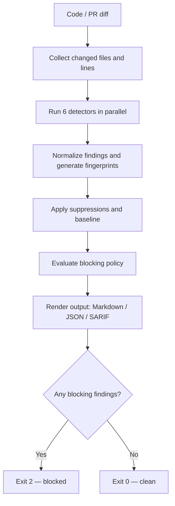

# Privacy Review Agent

An offline-first CLI tool that scans code for privacy and security risks — secrets, PII exposure, unsafe data transfers, and policy bypasses — before they reach production.

Run it locally, wire it as a pre-commit hook, or drop it into GitHub Actions CI.

---

## Installation

**Requirements:** Python 3.11+

```bash
git clone https://github.com/mukta2701/shiny-invention.git
cd shiny-invention
pip install -e .
```

Verify it installed:

```bash
privacy-review-agent --version
```

---

## Quick Start

Scan a folder:

```bash
privacy-review-agent scan --path ./src --format md
```

Scan only what changed in a pull request:

```bash
privacy-review-agent scan --base-ref origin/main --head-ref HEAD --format md
```

Run the built-in demo (safe fixture passes, unsafe fixture blocks):

```bash
make demo
```

---

## Commands

### Scan a path or PR diff

```bash
# Scan a local folder or file
privacy-review-agent scan --path <path> --format md

# Scan only changed lines in a git diff
privacy-review-agent scan --base-ref origin/main --head-ref HEAD --format md

# Output as JSON
privacy-review-agent scan --path ./src --format json

# Output as SARIF (for GitHub code scanning)
privacy-review-agent scan --path ./src --format sarif
```

### Create a baseline snapshot

Baseline an existing set of findings so they no longer block — useful when adopting the tool on a codebase with pre-existing issues.

```bash
privacy-review-agent baseline create --ref HEAD --output .privacy-review-baseline.json
```

### Calibrate detection thresholds

Run precision and recall checks against the included test fixtures:

```bash
privacy-review-agent calibrate --fixture-set tests/fixtures
```

### Enforce rerun approval gate

For CI use: blocks rerun unless a required label is present on the PR.

```bash
privacy-review-agent enforce-rerun-approval --required-label privacy-rerun-approved
```

---

## Exit Codes

| Code | Meaning |
|------|---------|
| `0` | No blocking findings |
| `1` | Runtime or configuration error |
| `2` | Blocking findings detected |

---

## What It Detects

Six risk categories:

| Category | Example |
|----------|---------|
| `SECRET_EXPOSURE` | Hardcoded API keys, tokens, passwords |
| `RAW_PII_LOGGING` | `console.log(user.email)` or `logger.info(req.body)` |
| `THIRD_PARTY_PII_TRANSFER` | Sending PII to an unapproved vendor endpoint |
| `PII_IN_MODEL_PROMPT` | Raw personal data passed into an LLM prompt |
| `INSUFFICIENT_REDACTION` | Sensitive fields logged without masking/hashing |
| `POLICY_BYPASS` | Consent or privacy checks hard-coded to skip |

Each finding includes: category, severity, confidence, file + line, evidence snippet, remediation suggestion, and a stable fingerprint for deduplication.

---

## Blocking Policy

A finding blocks only when **all** of these are true:

1. Severity is `critical` or `high`
2. Confidence is `high`
3. Finding is on changed lines (PR diff mode) or in the scanned path (local mode)
4. Finding is not suppressed
5. Finding is not in the baseline

`medium` and `low` findings are reported as warnings but never block.

---

## How It Works



---

## Suppressing False Positives

Add an entry to `.privacy-review-ignore.yaml` in your repo root:

```yaml
max_ttl_days: 14
require_github_issue: true
entries:
  - id: <fingerprint>
    reason: "This is a test fixture, not real PII"
    privacy_approver: your-name
    security_approver: your-name
    created_on: 2026-05-04
    expires_on: 2026-11-04
    ticket: https://github.com/your-org/your-repo/issues/123
```

Rules:
- Maximum TTL: 14 days
- Expired suppressions are automatically ignored
- No auto-renew

Get the fingerprint from the JSON output:

```bash
privacy-review-agent scan --path <file> --format json
```

---

## Pre-commit Hook (Global, All Repos)

Wire the agent to run automatically before every `git commit` on your machine:

```bash
# Install the agent
pip install -e .

# Create a global hooks directory
mkdir -p ~/.git-hooks

# Write the hook script
cat > ~/.git-hooks/pre-commit << 'EOF'
#!/bin/bash
export PATH="$HOME/Library/Python/3.13/bin:$PATH"

STAGED_FILES=$(git diff --cached --name-only --diff-filter=ACM 2>/dev/null)
[ -z "$STAGED_FILES" ] && exit 0

CODE_FILES=$(echo "$STAGED_FILES" | grep -E '\.(py|js|ts|tsx|jsx|yaml|yml|json|rb|go|java|env)$' || true)
[ -z "$CODE_FILES" ] && exit 0

BLOCK=0
for file in $CODE_FILES; do
    [ -f "$file" ] || continue
    privacy-review-agent scan --path "$file" --format md
    [ $? -eq 2 ] && BLOCK=1
done

if [ $BLOCK -eq 1 ]; then
    echo ""
    echo "Commit blocked: fix the critical/high risks above."
    echo "To suppress a false positive: add an entry to .privacy-review-ignore.yaml"
    echo "To skip in an emergency: git commit --no-verify"
    exit 1
fi
exit 0
EOF

chmod +x ~/.git-hooks/pre-commit

# Tell git to use this directory for all repos
git config --global core.hooksPath ~/.git-hooks
```

Behavior:
- `critical`/`high` findings → commit blocked
- `medium`/`low` findings → warning printed, commit allowed
- Clean code → silent, commit allowed

---

## CI Integration (GitHub Actions)

The workflow at `.github/workflows/privacy-review.yml` runs on every pull request:

- Scans only changed lines (not the full repo)
- Uploads findings as a SARIF report to GitHub Code Scanning
- Retains JSON artifacts for 90 days
- Enforces rerun approval if configured

To use it in your own repo, copy `.github/workflows/privacy-review.yml` and set these in your repo settings:

| Setting | Description |
|---------|-------------|
| `SECURITY_TEAM_SLUG` | GitHub team slug for rerun approval (`org/team-name`) |

---

## Running the Tests

```bash
# Lint + all tests
make verify

# Tests only
make test

# Calibration (precision ≥ 0.85, recall ≥ 0.80)
make calibrate
```

---

## Project Structure

```
src/privacy_review_agent/
├── cli.py              # Entry point
├── engine.py           # Orchestration and blocking logic
├── models.py           # Finding schema
├── detectors/          # 6 risk detectors
├── reporters/          # Markdown, JSON, SARIF output
└── policies/           # YAML policy files

tests/
├── unit/               # Unit tests per detector/component
├── integration/        # End-to-end CLI and CI contract tests
└── fixtures/
    ├── safe/           # Clean code — expected 0 findings
    └── unsafe/         # Intentionally risky code — used to validate detectors
```

---

## A Note on Test Fixtures

The `tests/fixtures/unsafe/` directory and some documentation examples contain intentionally risky code patterns (hardcoded keys, raw PII logging, etc.). These exist to validate that the detectors work correctly — they are not production code.

If you scan the entire repository, expect findings from those files. To see the tool working as intended on safe vs unsafe input, run:

```bash
make demo
```

---

## Further Reading

- [`ARCHITECTURE.md`](ARCHITECTURE.md) — design decisions, pipeline internals, governance model
- [`docs/plans/privacy-review-agent-spec.md`](docs/plans/privacy-review-agent-spec.md) — full specification
- [`docs/operations/runbook.md`](docs/operations/runbook.md) — day-to-day operational guide
