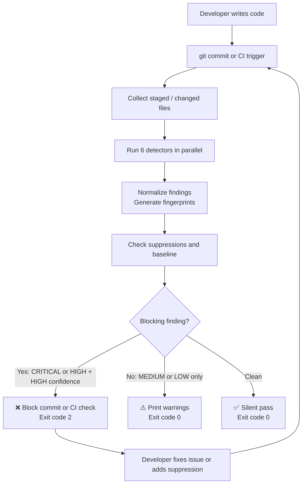
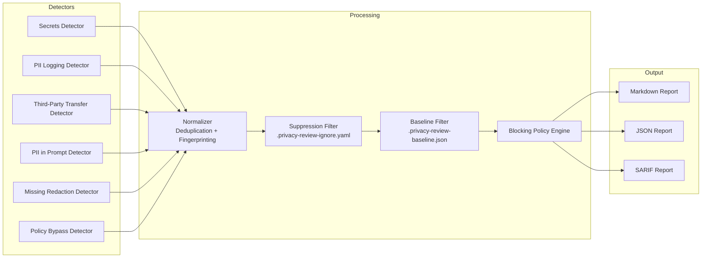
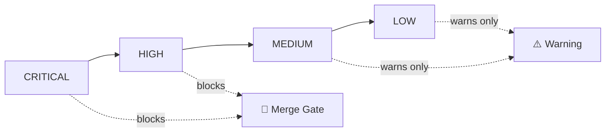
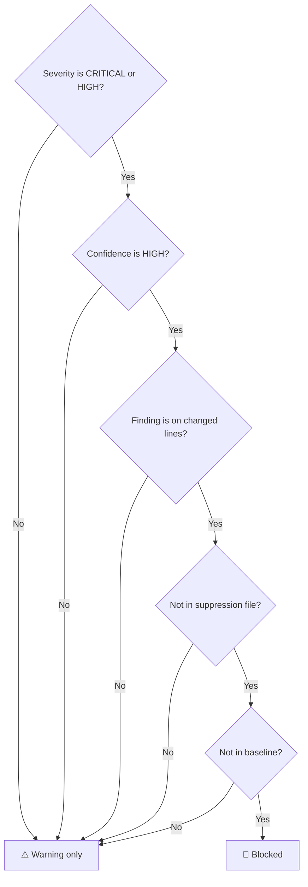
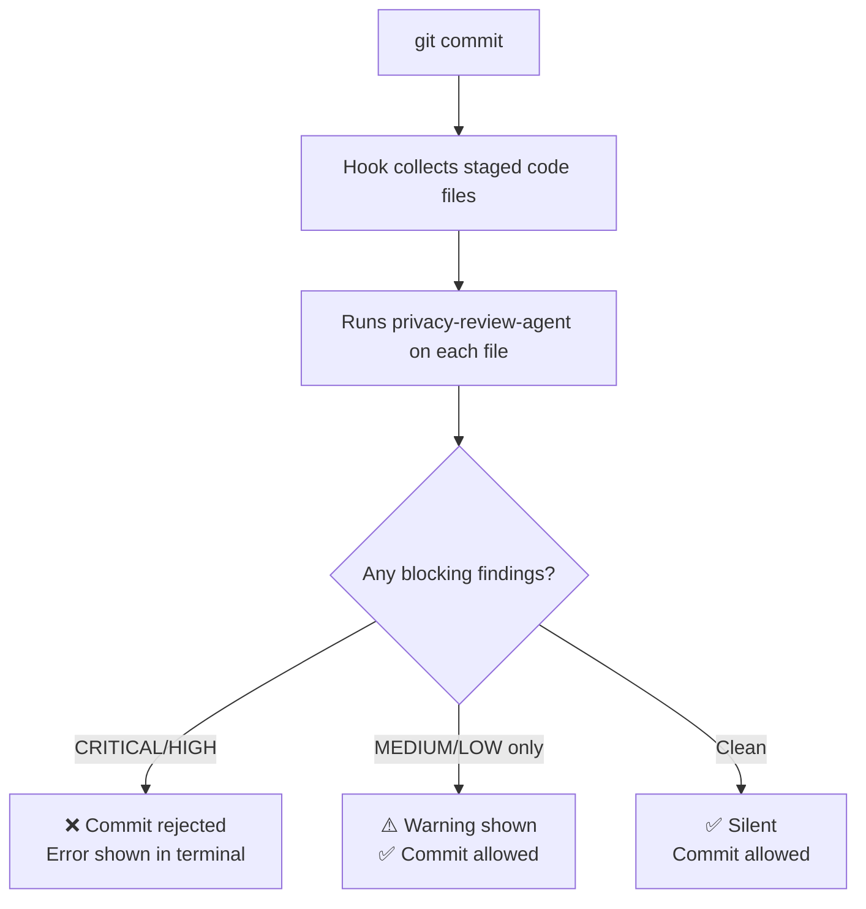
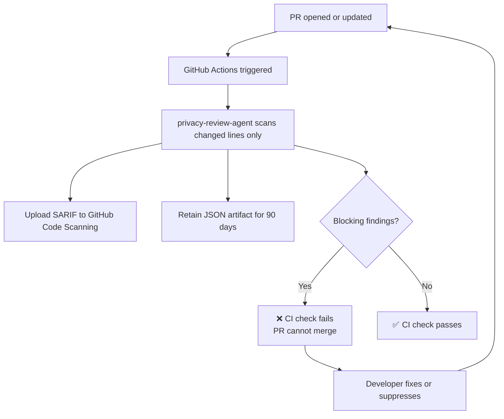

# Privacy Review Agent

> Catch secrets, PII leaks, and privacy policy violations in code — before they reach production.


---

## Table of Contents

- [What Is This?](#what-is-this)
- [The Problem It Solves](#the-problem-it-solves)
- [How It Works](#how-it-works)
- [What It Detects](#what-it-detects)
- [Tech Stack](#tech-stack)
- [Requirements](#requirements)
- [Installation](#installation)
- [Quick Start](#quick-start)
- [Command Reference](#command-reference)
- [Output Formats](#output-formats)
- [Blocking Policy](#blocking-policy)
- [Suppressing False Positives](#suppressing-false-positives)
- [Pre-commit Hook](#pre-commit-hook)
- [CI Integration](#ci-integration-github-actions)
- [Running Tests](#running-tests)
- [Project Structure](#project-structure)
- [Note on Test Fixtures](#note-on-test-fixtures)

---

## What Is This?

**Privacy Review Agent** is an offline-first command-line tool that automatically scans source code for privacy and security risks. It works as a standalone CLI, a git pre-commit hook, or a GitHub Actions CI gate.

It detects 6 categories of risk — hardcoded secrets, raw PII logging, unsafe third-party data transfers, PII passed into LLM prompts, missing data redaction, and privacy policy bypasses — and produces structured reports in Markdown, JSON, or SARIF format.

No data leaves your machine by default. Everything runs locally.

---

## The Problem It Solves

Privacy and security bugs in code are often caught too late — during a production incident, a compliance audit, or a data breach. Manual code review doesn't scale. Existing tools focus on secrets but miss broader privacy risks like PII in logs, data sent to unapproved vendors, or unredacted fields passed into AI models.

This tool closes that gap by running deterministic, policy-driven checks automatically at commit time or in CI — catching issues before they are ever merged.

---

## How It Works



### Detection Pipeline



---

## What It Detects

| Risk Category | Description | Example |
|---|---|---|
| `SECRET_EXPOSURE` | Hardcoded API keys, tokens, passwords in source code | an `API_KEY` value (omitted) |
| `RAW_PII_LOGGING` | Personal data logged without redaction | `logger.info(…)` with a contact field |
| `THIRD_PARTY_PII_TRANSFER` | PII sent to an unapproved external endpoint | `requests.post(…)` with a contact field |
| `PII_IN_MODEL_PROMPT` | Raw personal data passed into an LLM prompt | `f"…"` built from a contact field |
| `INSUFFICIENT_REDACTION` | Sensitive fields emitted without masking or hashing | `log.write(…)` with contact fields |
| `POLICY_BYPASS` | Consent or privacy checks hard-coded to pass | a hard-coded branch that always passes |

Keyword matching is whole-word and identifier-aware: markers match complete
word parts, so `name` matches `userName` but not `filename`, and `token`
matches `authToken` but not `max_tokens`. Full-line `#` and `//` comments are
skipped by the keyword detectors. Secret detection always runs its built-in
patterns and merges them with gitleaks results when gitleaks is available.

### Severity Model



---

## Tech Stack

| Layer | Technology |
|---|---|
| Language | Python 3.11+ |
| CLI Framework | [Click](https://click.palletsprojects.com/) |
| Policy Files | YAML via [PyYAML](https://pyyaml.org/) |
| Testing | [Pytest](https://pytest.org/) |
| Linting | [Ruff](https://docs.astral.sh/ruff/) |
| CI | GitHub Actions |
| Security Output | [SARIF 2.1.0](https://sarifweb.azurewebsites.net/) |
| Optional | [Gitleaks](https://github.com/gitleaks/gitleaks) (enhanced secret scanning) |

---

## Requirements

- Python **3.11 or higher**
- pip
- git (for diff-mode scanning and the pre-commit hook)
- Optional: [Gitleaks](https://github.com/gitleaks/gitleaks) binary on your PATH for enhanced secret detection (regex results are always included and merged with gitleaks findings)

---

## Installation

```bash
# 1. Clone the repository
git clone https://github.com/mukta2701/shiny-invention.git
cd shiny-invention

# 2. Install the package (creates the `privacy-review-agent` command)
pip install -e .

# 3. Verify installation
privacy-review-agent --version
```

Expected output:
```
privacy-review-agent, version 0.1.0
```

---

## Quick Start

**Scan a folder:**
```bash
privacy-review-agent scan --path ./src --format md
```

**Scan only what changed in a branch:**
```bash
privacy-review-agent scan --base-ref origin/main --head-ref HEAD --format md
```

**Run the built-in demo** (shows a blocked unsafe scan and a clean safe scan):
```bash
make demo
```

### Example Output

```
# Privacy Review Report

- Findings: 1
- Blocking: 1

## [BLOCK] SECRET_EXPOSURE — src/config.py:12
- Severity: `critical`
- Confidence: `high`
- Message: Potential hardcoded secret detected
- Evidence: an `API_KEY` value (omitted)
- Remediation: Remove secret from code, rotate credential, move to a secret manager.
- Fingerprint: `b07ecfb56cf596a9`
```

---

## Command Reference

### `scan` — Detect risks in code

```bash
# Scan a file or directory
privacy-review-agent scan --path <path> --format [md|json|sarif]

# Scan only changed lines in a git diff
privacy-review-agent scan --base-ref <ref> --head-ref <ref> --format [md|json|sarif]

# Load a baseline to suppress pre-existing findings
privacy-review-agent scan --path ./src --baseline-file .privacy-review-baseline.json --format md

# Use a custom policy directory
privacy-review-agent scan --path ./src --policies-dir ./my-policies --format md
```

### `baseline` — Snapshot existing findings

Useful when adopting the tool on a codebase that already has existing issues. Findings in the baseline are not blocking.

```bash
privacy-review-agent baseline create --ref HEAD --output .privacy-review-baseline.json
```

### `calibrate` — Validate detection accuracy

Runs the agent against the included safe and unsafe fixtures plus the
labelled corpus, and checks the release gate: near-miss precision
above 0.90, corpus recall at least 0.80 with known gaps excluded,
deterministic output, and no regression on unsafe fixtures.

```bash
privacy-review-agent calibrate --fixture-set tests/fixtures
```

### `enforce-rerun-approval` — Gate CI reruns

Blocks a CI rerun unless the required label is present on the pull request. Prevents bypassing findings by simply re-running the check.

```bash
privacy-review-agent enforce-rerun-approval --required-label privacy-rerun-approved
```

---

## Output Formats

| Format | Flag | Best For |
|---|---|---|
| Markdown | `--format md` | Reading in terminal or PR comments |
| JSON | `--format json` | Programmatic processing, integrations |
| SARIF | `--format sarif` | GitHub Code Scanning, security dashboards |

```bash
# JSON output
privacy-review-agent scan --path ./src --format json

# SARIF output (pipe to file for GitHub upload)
privacy-review-agent scan --path ./src --format sarif > results.sarif
```

---

## Blocking Policy

A finding blocks a commit or CI check only when **all five** conditions are true:



---

## Suppressing False Positives

If the agent flags something that is not a real risk, add a suppression entry to `.privacy-review-ignore.yaml` in your project root.

```yaml
max_ttl_days: 14
require_github_issue: true
entries:
  - id: b07ecfb56cf596a9          # fingerprint from JSON output
    reason: "Test fixture — not real PII"
    privacy_approver: your-name
    security_approver: your-name
    created_on: 2026-05-04
    expires_on: 2026-11-04
    ticket: https://github.com/your-org/your-repo/issues/42
```

**Rules:**
- Suppressions expire automatically after `expires_on`
- Maximum TTL is 14 days
- Expired entries are ignored (no auto-renew)
- A GitHub issue link is required

Get the fingerprint by running a JSON scan:
```bash
privacy-review-agent scan --path <file> --format json | python3 -m json.tool
```

---

## Pre-commit Hook

Wire the agent to run automatically before every `git commit` — on every repo on your machine.

```bash
# Step 1: Install the agent
pip install -e .

# Step 2: Create a global hooks directory
mkdir -p ~/.git-hooks

# Step 3: Write the hook script
cat > ~/.git-hooks/pre-commit << 'EOF'
#!/bin/bash
export PATH="$HOME/Library/Python/3.13/bin:$PATH"

STAGED_FILES=$(git diff --cached --name-only --diff-filter=ACM 2>/dev/null)
[ -z "$STAGED_FILES" ] && exit 0

CODE_FILES=$(echo "$STAGED_FILES" | grep -E '\.(py|js|ts|tsx|jsx|yaml|yml|json|rb|go|java|env)$' || true)
[ -z "$CODE_FILES" ] && exit 0

BLOCK=0
for file in $CODE_FILES; do
    [ -f "$file" ] || continue
    privacy-review-agent scan --path "$file" --format md
    [ $? -eq 2 ] && BLOCK=1
done

if [ $BLOCK -eq 1 ]; then
    echo ""
    echo "Commit blocked: fix the critical/high risks above."
    echo "Suppress a false positive: add an entry to .privacy-review-ignore.yaml"
    echo "Emergency bypass: git commit --no-verify"
    exit 1
fi
exit 0
EOF

# Step 4: Make it executable
chmod +x ~/.git-hooks/pre-commit

# Step 5: Tell git to use this directory globally
git config --global core.hooksPath ~/.git-hooks
```

**What happens at commit time:**



**Emergency bypass** (use sparingly):
```bash
git commit --no-verify -m "your message"
```

---

## CI Integration (GitHub Actions)

The workflow at `.github/workflows/privacy-review.yml` runs automatically on every pull request.



**To use in your own repository:**

1. Copy `.github/workflows/privacy-review.yml` to your repo
2. Set `SECURITY_TEAM_SLUG` in your repo secrets (format: `org/team-name`) for rerun approval enforcement

---

## Running Tests

```bash
# Lint + all tests
make verify

# Tests only
make test

# Calibration check (near-miss precision > 0.90, corpus recall >= 0.80)
make calibrate

# Scan safe fixtures (expect 0 findings)
make scan-safe

# Scan unsafe fixtures (expect blocking findings)
make scan-unsafe
```

Current calibration results: **near-miss precision 1.0, corpus recall 1.0, deterministic output, unsafe recall 1.0** on the 193-case labelled corpus.

---

## Project Structure

```
shiny-invention/
│
├── src/privacy_review_agent/
│   ├── cli.py                  # Entry point — Click commands
│   ├── engine.py               # Orchestration, blocking logic
│   ├── models.py               # Finding dataclass and fingerprinting
│   ├── config.py               # Settings and policy loader
│   ├── git_diff.py             # Git integration for diff-mode scanning
│   ├── suppressions.py         # Suppression policy with TTL validation
│   ├── utils.py                # Shared helpers
│   │
│   ├── detectors/              # One file per risk category
│   │   ├── base.py
│   │   ├── secrets.py          # SECRET_EXPOSURE
│   │   ├── pii_logging.py      # RAW_PII_LOGGING
│   │   ├── third_party_transfer.py  # THIRD_PARTY_PII_TRANSFER
│   │   ├── pii_in_prompts.py   # PII_IN_MODEL_PROMPT
│   │   ├── missing_redaction.py     # INSUFFICIENT_REDACTION
│   │   └── policy_bypass.py    # POLICY_BYPASS
│   │
│   ├── reporters/              # Output format renderers
│   │   ├── markdown_reporter.py
│   │   ├── json_reporter.py
│   │   └── sarif_reporter.py
│   │
│   └── policies/               # YAML policy configuration
│       ├── taxonomy.yaml        # Risk categories and severity defaults
│       ├── sensitive_fields.yaml  # Field names treated as sensitive
│       ├── redaction_rules.yaml   # Approved redaction helpers
│       ├── vendor_allowlist.yaml  # Approved external vendors
│       ├── bypass_rules.yaml      # Known bypass patterns
│       └── prompt_rules.yaml      # LLM prompt risk patterns
│
├── tests/
│   ├── unit/                   # Per-component unit tests
│   ├── integration/            # End-to-end CLI tests
│   └── fixtures/
│       ├── safe/clean.py       # Clean file — expected 0 findings
│       ├── labelled/cases.jsonl  # Labelled corpus (base64 lines)
│       └── unsafe/             # Intentionally risky code per category
│
├── docs/
│   ├── plans/                  # Specification and implementation plans
│   ├── operations/             # Runbook and calibration guide
│   └── superpowers/            # Design specs and brainstorming docs
│
├── .github/workflows/
│   ├── ci.yml                  # Lint and test on every push
│   └── privacy-review.yml      # Privacy scan on pull requests
│
├── .privacy-review-ignore.yaml # Suppression entries
├── .pre-commit-config.yaml     # pre-commit framework config
├── pyproject.toml              # Package metadata and tool config
├── Makefile                    # Common tasks
└── ARCHITECTURE.md             # Design decisions and internals
```

---

## Exit Codes

| Code | Meaning |
|------|---------|
| `0` | No blocking findings (clean or warnings only) |
| `1` | Runtime or configuration error |
| `2` | One or more blocking findings detected |

---

## Note on Test Fixtures

`tests/fixtures/unsafe/` contains intentionally risky code — hardcoded keys, raw PII logging, policy bypasses — used to validate that every detector works correctly. These are **test inputs, not production code**.

If you scan the entire repository, you will see findings from these files. That is expected and correct. To see the tool working as intended, run:

```bash
make demo
```

This scans the unsafe fixtures (exits 2, findings shown) and the safe fixture (exits 0, silent) back to back.

---

## Further Reading

- [`ARCHITECTURE.md`](ARCHITECTURE.md) — deep dive into design decisions, the blocking policy, governance model, and operating modes
- [`docs/plans/privacy-review-agent-spec.md`](docs/plans/privacy-review-agent-spec.md) — full original specification
- [`docs/operations/runbook.md`](docs/operations/runbook.md) — operational guide for day-to-day use
- [`docs/operations/calibration.md`](docs/operations/calibration.md) — calibration targets and how to tune thresholds
